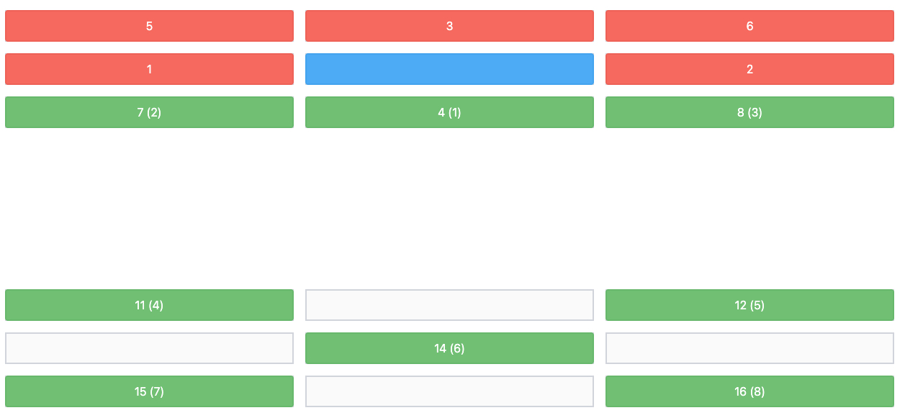

# ArrowTab

**ArrowTab** allows you to **navigate** a webpage **using the arrow keys**, automatically selecting the nearest focusable element. This enables fast and efficient keyboard-only navigation across the page.

ArrowTab is particularly **useful for business applications**, where power users need to prioritize **high productivity**.

Instead of hitting `Tab` repeatedly, you can simply use the arrow keys to indicate the direction and jump to the next input, button, or link you want to select.

ArrowTab's default settings work well, but they are not always a plug-and-play solution. It helps if you **build your app with ArrowTab in mind**. For example, aligning your focusable elements into a grid and considering the placement of your navigation. The idea is to integrate ArrowTab into your app from the beginning, not to add it as an afterthought.

## Input Behavior Changes

ArrowTab slightly modifies the behavior of some input elements to enhance keyboard navigation. For example, number inputs will not change their value when using the up and down arrow keys; instead, the focus will move to the element above or below.

To revert to the native behavior, press `Shift` + `Arrow Key`.

Arrow keys combined with `Alt`, `Ctrl` or `Meta` / `Cmd` are left to the browser and OS (e.g. word jumps or history navigation).

If there is nothing to navigate to, the arrow key keeps its native behavior, so the page can still scroll. Only fields that would change their value (e.g. number inputs, selects, radio buttons) never react to arrow keys.

Text fields keep the arrow keys as long as the caret can move: left / right leave an input once the caret is at the start / end, up / down leave a textarea or `contenteditable` once the caret is in the first / last line (soft wrapped lines included).

## Installation

pnpm:

```sh
pnpm install arrowtab
```

yarn:

```sh
yarn add arrowtab
```

npm:

```sh
npm install arrowtab
```

## Usage

Vanilla JS:

```ts
import { initArrowTab } from 'arrowtab'

initArrowTab()
```

React:

```tsx
'use client'

import { useEffect } from 'react'
import { initArrowTab } from 'arrowtab'

export const ArrowTab = () => {
  useEffect(() => {
    const { cleanup } = initArrowTab()

    return () => {
      cleanup()
    }
  }, [])

  return null
}
```

### Cleanup

If you want to remove the ArrowTab event listener, you can call the `cleanup` function. This is useful if you use ArrowTab in a `useEffect` hook.

```ts
const { cleanup } = initArrowTab()

cleanup()
```

## Options

You can pass options to the `initArrowTab` function. For example:

```ts
initArrowTab({
  debug: true,
  autoDetectHistory: true,
})
```

### debug

default: `false`

If debug is set to `true`, ArrowTab will log debug information to the console. It also enables the visual debug mode. To activate the visual debug mode, press `Ctrl` + `Arrow Key`. For example, `Ctrl` + `Arrow Down` will highlight all the focusable elements.

Here is an example:

<div style="padding:10px; background:white; border-radius:4px; margin-bottom:1rem">
  
</div>

Blue indicates the current element. Green indicates focusable elements that are within reach, and red indicates those that are not within reach.

The numbers represent the order of the focusable elements. The numbers in parentheses represent the order of the focusable elements that are within reach. Lower numbers are closer to the current element.

If you click on a focusable element, debug information will be logged to the console.

To deactivate the visual debug mode, press `Esc`.

### autoDetectHistory

default: `false`

If `true`, ArrowTab detects dialogs (`role="dialog"`, `role="alertdialog"`, `<dialog>`) and refocuses the element that was focused before the dialog opened, once the dialog closes. Dialogs rendered into portal wrappers and nested dialogs are supported.

ArrowTab only steps in if focus got lost. Dialog libraries that restore focus themselves are left alone.

### strategy

default: `'spatial'`

How the next element is chosen:

- `'spatial'`: Compares the edges of the elements, like Android's focus navigation. Elements in the same row / column win, elements of different sizes and slightly misaligned elements are handled well.
- `'grid'`: Compares the centers of the elements. Up / down jump to the nearest row and then to the nearest column, left / right stay in the current row.
- A custom function. It gets the rect of the focused element, all candidates and the direction and returns the candidates sorted by preference:

```ts
import { initArrowTab, spatial, type Strategy } from 'arrowtab'

const strategy: Strategy = ({ origin, candidates, direction }) =>
  spatial({
    origin,
    direction,
    candidates: candidates.filter(
      ({ element }) => !element.matches('.skip-me'),
    ),
  })

initArrowTab({ strategy })
```

### root

default: the whole document

Only navigate inside this element. Arrow keys outside of it are ignored.

```ts
initArrowTab({ root: document.querySelector('#app') })
```

Calling `initArrowTab` twice for the same root logs a warning. Call `cleanup()` of the first instance before initializing it again.

## Events

Before focus moves, ArrowTab dispatches a cancelable `arrowtab:navigate` event on the focused element (or the document if nothing is focused). It bubbles and crosses shadow roots. Call `preventDefault()` to stop the navigation:

```ts
import { navigateEventName } from 'arrowtab'

document.addEventListener(navigateEventName, (event) => {
  const { from, to, direction } = event.detail
  if (to.matches('.locked')) event.preventDefault()
})
```

## Special Cases

### Going back

Pressing the opposite arrow key returns to the element focus came from, e.g. down from a narrow button to a wide one and up again lands on the same narrow button.

### Hidden elements and scrolling

Elements that are completely hidden by an ancestor with `overflow: hidden` or `overflow: clip` (e.g. inactive carousel slides) are skipped. Elements in scroll containers stay reachable.

Focusing an element scrolls as little as possible. If you have a sticky header, set [`scroll-padding-top`](https://developer.mozilla.org/en-US/docs/Web/CSS/scroll-padding-top) on the scroll container so focused elements don't end up behind it.

### Shadow DOM

Focusable elements inside open shadow roots are found, so ArrowTab works with web components. `data-arrowtab` attributes on the host apply to its shadow content. `autoDetectHistory` doesn't detect dialogs inside shadow roots.

### Modals and scopes

If focus is inside a dialog (`<dialog>`, `role="dialog"`, `role="alertdialog"` or `aria-modal="true"`), arrow keys keep it inside. Non-modal dialogs can still be left with `Tab`.

If focus is behind an open modal (`aria-modal="true"` or a `<dialog>` opened with `showModal()`), the next arrow key moves it into the modal.

Use `data-arrowtab="scope"` to keep navigation inside any other container, or `data-arrowtab="wrap"` to also jump to the opposite edge at the end.

### ARIA widgets

Composite widgets implement their own arrow key navigation, so ArrowTab leaves the keys to them:

| Role                                             | Keys left to the widget |
| ------------------------------------------------ | ----------------------- |
| `grid`, `treegrid`, `radiogroup`                 | all                     |
| `listbox`, `menu`, `tree`                        | up / down               |
| `menubar`, `tablist`, `toolbar`                  | left / right            |
| open `combobox` / popup (`aria-expanded="true"`) | up / down               |

`aria-orientation` overrides the default orientation. If a widget doesn't handle arrow keys itself, add `data-arrowtab="enable"` to it.

### Lost focus

If the focused element is removed or focus is lost otherwise, ArrowTab navigates from the position of the last focused element instead of starting at the top of the page.

### Focusable containers

If a focusable container (e.g. a card with `tabindex="0"`) is focused, down / right move into it.

## data-arrowtab

You can control the behavior of ArrowTab by adding a `data-arrowtab` attribute to any element. Separate the keywords with a space. For example: `<div data-arrowtab="disable-left disable-right">`

Here are the available keywords:

### disable, disable-${key}

Sometimes your components are listening to arrow keys themselves. In that case, you can disable ArrowTab for that element by adding the `disable` attribute.

If you only want to disable a specific key, then use: `disable-left`, `disable-right`, `disable-up`, `disable-down`.

### scope

Keeps navigation inside this element while focus is inside it. See [Modals and scopes](#modals-and-scopes).

### wrap

Like `scope`, but at the edge focus jumps to the opposite side, preferably in the same row / column. Add it to `<body>` to wrap around the whole page.

### skip

The element (and its children) is skipped by the arrow keys but stays reachable with `Tab`. Useful for e.g. help links next to every field.

### arrow-only

Makes elements with a negative `tabindex` inside this element (or the element itself) reachable with the arrow keys. `Tab` still skips them. Useful for large grids, e.g. a calendar with one button per time slot: the arrow keys step across the slots and `Tab` jumps over the whole grid.

```html
<div data-arrowtab="arrow-only">
  <button tabindex="-1">Mon 08:00</button>
  <button tabindex="-1">Mon 08:30</button>
  <!-- ... -->
</div>
```

Make sure the grid can still be entered with `Tab`, e.g. by giving one slot `tabindex="0"`. Disabled, hidden and `skip` elements stay excluded.

### enable

Turns off the [ARIA widget](#aria-widgets) detection for this element and its children.

## Development

```sh
pnpm dev
```

A demo page will open in your browser at `http://localhost:8080`.

If you want to use the library in your app, you can use the following code:

```ts
import { initArrowTab } from 'http://localhost:8080/dist/index.js'

initArrowTab()
```

Or as a script tag:

```html
<script type="module">
  import { initArrowTab } from 'http://localhost:8080/dist/index.js'

  initArrowTab()
</script>
```
